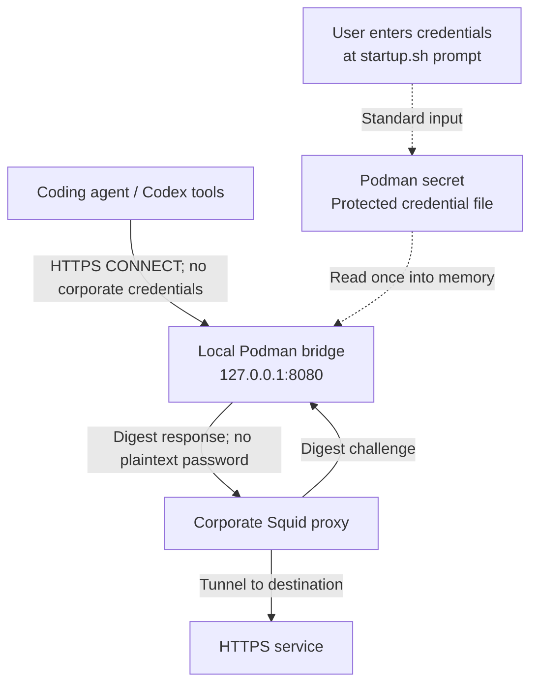

# Squid Digest Bridge

Let a coding agent such as Codex reach HTTPS services through a corporate Squid
proxy that requires Digest authentication. The agent's tools use the local
proxy at `http://127.0.0.1:8080`; the bridge handles corporate authentication,
so the agent does not need the corporate username or password in its proxy
configuration.



Passwords are not saved in `.env`, passed as Podman command arguments, or
injected into the container environment. **Credentials are stored in a Podman
secret and retained in bridge memory**; the secret survives shutdown and is
not encrypted by default. Digest authentication sends a computed response
instead of the plaintext password to the corporate proxy.

Configure the agent's proxy-aware tools to use `http://127.0.0.1:8080` from the
host running the bridge. These tools must support an HTTP proxy for HTTPS
CONNECT requests. The bridge currently supports HTTPS tunnels only; ordinary
HTTP requests return `501 Not Implemented`.

Install [Podman](https://podman.io/docs/installation) before starting. If Podman
is missing from `PATH`, `startup.sh` detects your operating system (macOS,
Windows, or Linux) and prints the relevant installation instructions before
exiting, without requesting configuration or credentials. WSL uses the Linux
instructions.

Copy `.env.sample` to `.env` and set `UPSTREAM_SQUID_HOST` and
`UPSTREAM_SQUID_PORT` to your upstream proxy endpoint. Use plain, unquoted
`KEY=value` entries. The `.env` file is ignored by Git.

Run `./startup.sh`. The script prompts for your username and password, with
password input hidden:

```sh
./startup.sh
```

Each prompt is skipped if its corresponding variable (`PROXY_DIGEST_USER` or
`PROXY_DIGEST_PASS`) is already exported and non-empty. Export both variables for
non-interactive startup. Prompted credentials stay inside the startup process,
leaving your calling shell unchanged. Empty usernames and
passwords are rejected.

Stop the bridge with:

```sh
./shutdown.sh
```

This stops the container and preserves its credential secret. Run `./startup.sh`
to start again with fresh credentials.

`startup.sh` reads the two upstream settings from `.env` beside the script.
Exported variables override `.env` values. Both settings are required; there
are no built-in defaults. Other `.env` entries, including credentials, are ignored.

`startup.sh` uses Podman directly, replacing the previous Compose configuration.

The script removes credential environment variables before invoking Podman and
sends the username and password through standard input to a native Podman
secret named `squid-digest-bridge-credentials`. It then recreates the container
with that secret mounted at `/run/secrets/proxy_digest_credentials` with mode
`0400`. Credentials are never passed as container environment variables or
command arguments. Podman's default secret driver stores a protected file in
its own storage; it is not encrypted by default.

The bridge reads the secret file once at startup, before listening, and unsets
the two upstream configuration variables. Missing or invalid credentials cause
startup to fail. `env`, `/proc/1/environ`, and `podman inspect`'s container
environment do not contain the proxy credentials. New `podman exec` processes do
not inherit them either.

Credentials remain in Python memory for subsequent Digest challenges and in the
secret file so the container can restart automatically. Container root or a
process with access to the bridge's memory can still read them. Run `./startup.sh`
again to apply new credentials; ordinary restarts reuse the existing secret
file. If credentials were exported in your calling shell, unset them there
after startup when no longer needed.

Run the local regression checks with `python3 -m unittest discover -s tests`.
