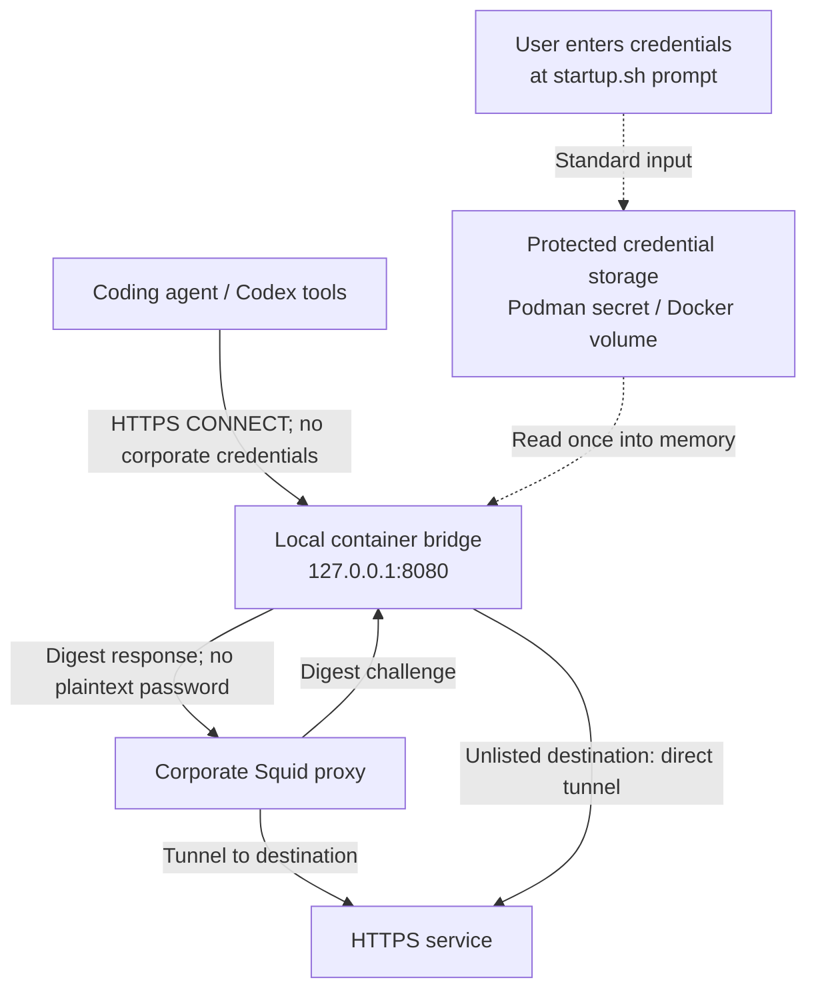

# Squid Digest Bridge

Let a coding agent such as Codex reach HTTPS services through a corporate Squid
proxy that requires Digest authentication. The agent's tools use the local
proxy at `127.0.0.1:8080`, authenticated with a separate local token; the bridge handles corporate authentication,
so the agent does not need the corporate username or password in its proxy
configuration.

Optionally route only selected domains through Squid and connect to everything
else directly from the bridge container.



Corporate passwords are not saved in `.env`, passed as runtime command arguments, or
injected into the container environment. **Corporate credentials are retained in bridge
memory and persistent runtime storage**: a Podman secret or a Docker volume.
These stores survive shutdown and have no application-level encryption. Digest
authentication sends a computed response instead of the plaintext password to
the corporate proxy.

After startup, configure the agent's proxy-aware tools with username `bridge`
and the local token in `.bridge-client-token`. For tools using `HTTPS_PROXY`,
run this from the repository directory:

```sh
export HTTPS_PROXY="http://bridge:$(cat .bridge-client-token)@127.0.0.1:8080"
```

The local token grants access to the bridge; it is separate from the corporate
username/password. Startup generates it automatically, protects the file with
mode `0600`, and reuses it across restarts and shutdown. It is ignored by Git
and mounted read-only at `/run/bridge/bridge_client_token`, outside the
corporate credential volume at `/run/secrets`. This lets Docker/OrbStack create
both mountpoints without writing inside a read-only volume. It is never passed in runtime command
arguments or container environment variables. Requests without valid local
credentials return `407 Proxy Authentication Required` before any outbound
connection. The local authentication header is never forwarded to Squid or a
direct destination. To rotate the token, remove `.bridge-client-token`, rerun
`./startup.sh`, and update your tools' proxy configuration.

Use the proxy from the host running the bridge. Tools must support an HTTP proxy for HTTPS
CONNECT requests. The bridge currently supports HTTPS tunnels only; ordinary
HTTP requests return `501 Not Implemented`.

To enable selective routing, copy `proxy-domains.txt.sample` to
`proxy-domains.txt`, edit the domains, and set this in `.env`:

```dotenv
PROXY_DOMAINS_FILE=proxy-domains.txt
```

Relative paths resolve beside `startup.sh`; absolute paths also work. The
default `proxy-domains.txt` is ignored by Git. Use one hostname rule per line:

```text
api.example.com     # Only api.example.com
.example.net        # example.net and every subdomain
```

The syntax follows Squid's [hostname matching rules](https://wiki.squid-cache.org/SquidFaq/SquidAcl).
Matching ignores case and a single trailing DNS dot, and respects domain
boundaries: `.example.net` never matches `notexample.net` or
`example.net.other`. Blank lines and `#` comments are allowed. Rules accept ASCII
hostnames, including punycode; wildcards such as `*.example.com`, URLs, IP
addresses, ports, and complete `acl` declarations are rejected. When a list is
configured, literal IPv4/IPv6 destinations go direct; no reverse DNS is used to
decide the route.

| Domain configuration | Behavior |
| --- | --- |
| `PROXY_DOMAINS_FILE` unset or empty | All destinations use Squid, preserving the default behavior |
| Configured file contains rules | Matches use Squid; other destinations go direct |
| Configured file is empty or contains only comments | All destinations go direct; no upstream settings or credentials needed |
| Configured file is missing, unreadable, or invalid | Startup fails before credentials or container replacement |

Routing is strict: neither route falls back to the other when it fails. Direct
connections resolve DNS inside the container and use its network reachability.
The bridge sends `200 Connection established` only after opening the direct
connection; it never sends the proxy CONNECT headers or corporate credentials
to the destination. Connection failures return `502 Bad Gateway`; a 10-second
connection/negotiation timeout returns `504 Gateway Timeout`. Invalid CONNECT
targets return `400 Bad Request`. Squid rejection responses are forwarded to
the client without a direct retry.

Startup validates configured lists inside the Python image, using the same
parser as the bridge, and mounts the file read-only. Rules are loaded once per
process; editing the file does not change a running bridge's routing. Rerun
`./startup.sh` to validate and apply edits.

Install and start one of these Linux container runtimes:

| Runtime | Installation | `CONTAINER_RUNTIME` |
| --- | --- | --- |
| Podman | [Setup guide](https://podman.io/docs/installation); on macOS/Windows, initialize and start a Podman machine | `podman` |
| Docker Engine / Docker Desktop | [Setup guide](https://docs.docker.com/get-started/get-docker/) | `docker` |
| OrbStack (macOS) | [Setup guide](https://docs.orbstack.dev/quick-start) | `orbstack` |

The scripts require Bash, including on Windows (for example, Git Bash). WSL uses
the Linux runtime behavior. Windows containers are not supported.

`CONTAINER_RUNTIME=auto` is the default. On the first startup it prefers OrbStack
when the Docker CLI and its `orbstack` context exist, then Docker, then Podman.
Docker uses its current context,
including `DOCKER_CONTEXT` or `DOCKER_HOST` overrides. OrbStack explicitly uses
`docker --context orbstack`; it never changes your global Docker context.
An installed engine that cannot connect causes an error, with no automatic
fallback. Missing CLIs produce installation help before any credential prompt.

Copy `.env.sample` to `.env` and set `UPSTREAM_SQUID_HOST` and
`UPSTREAM_SQUID_PORT` to your upstream proxy endpoint, unless using an empty
domain file for direct-only operation. Use plain, unquoted
`KEY=value` entries. The `.env` file is ignored by Git.

Optionally set `CONTAINER_RUNTIME` in `.env`, or override it for one invocation:

```sh
CONTAINER_RUNTIME=orbstack ./startup.sh
# Or: CONTAINER_RUNTIME=docker ./startup.sh
```

Run `./startup.sh`. When Squid is needed, the script prompts for your username
and password, with password input hidden:

```sh
./startup.sh
```

Each prompt is skipped if its corresponding variable (`PROXY_DIGEST_USER` or
`PROXY_DIGEST_PASS`) is already exported and non-empty. Export both variables for
non-interactive startup. Prompted credentials stay inside the startup process,
leaving your calling shell unchanged. Empty usernames and
passwords are rejected.

Stop the bridge with:

```sh
./shutdown.sh
```

This stops the container and preserves its credentials. Run `./startup.sh`
to start again with fresh credentials.

The bridge joins a dedicated project-managed network named
`squid-digest-bridge-network`, rather than the engine's default network.
Startup refuses to reuse an unmanaged network with that name. The host port
remains bound to `127.0.0.1`. Client authentication also protects access on
runtimes where bridge networks are not isolated from one another. Treat the
host and container-engine administrators as trusted; do not attach untrusted
containers to the bridge's dedicated network or share its client token.
Shutdown retains the network for restarts. After permanently removing the
bridge container, its network can be removed with the same runtime's
`network rm squid-digest-bridge-network` command.

Client and upstream header blocks are limited to 32 KiB. Oversized client
headers receive `431 Request Header Fields Too Large`; oversized upstream
responses fail with `502 Bad Gateway`. At most 100 clients are handled at once,
including pending headers and established tunnels; excess clients are closed
immediately. Pending headers and connection setup have 10-second timeouts.

Upstream Digest authentication supports MD5 with `qop=auth`, including the
standard default of MD5 when `algorithm` is omitted. Unsupported algorithms,
missing/unsupported `qop`, malformed challenges, and duplicate parameters fail
with `502`; the bridge does not retry with legacy Digest or another
authentication scheme. Digest values are escaped and control characters are
rejected. The Squid connection still uses plain TCP: Digest keeps the plaintext
password off the wire, but does not encrypt the exchange or prevent offline
password guessing by an observer on that connection.

`startup.sh` reads `UPSTREAM_SQUID_HOST`, `UPSTREAM_SQUID_PORT`, and
`CONTAINER_RUNTIME`, and `PROXY_DOMAINS_FILE` from `.env` beside the script.
Exported variables override `.env` values. Both upstream settings are required
when Squid is needed; there are no built-in defaults. Values are literal,
unquoted text; other entries, including
credentials, are ignored. `runtime.sh` shares configuration and connection
handling between the startup and shutdown scripts.

A successful startup saves its runtime and connection settings in the ignored
`.bridge-runtime` file, with owner-only permissions and no proxy credentials.
Automatic startup reuses that target, and shutdown always uses it, even if you
change Docker's global context or export a different runtime. Named contexts
and Podman connections must still exist and refer to the same engine.
On Linux, Podman uses local storage unless `CONTAINER_CONNECTION` or
`CONTAINER_HOST` selects a remote service. macOS/Windows use the default Podman
connection. Docker host overrides also retain their TLS settings and certificate
path for shutdown; certificate contents are never copied into the state file.

To switch engines or connections, run `./shutdown.sh` first, then start with the
new selection. Successful shutdown removes the runtime state file. Each engine
keeps its own stopped container and credentials; switching does not transfer or
delete those credentials. The published proxy is intended for tools on the
same host, so use a local engine or local VM with working port forwarding and
repository file sharing. Arbitrary remote hosts are not a supported deployment.

The scripts use the runtime CLI directly. Podman retains native `--replace`
behavior. Docker replaces only containers labeled as managed by this project.
Startup prepares the image and credential storage before replacing the current
container. Replacement briefly interrupts connections. If the final container
launch fails after replacement, rerun startup; it does not restore the old
container. Failed Docker launches clean up the new container and volume where
possible. Preparation failures leave the existing container and credentials
intact.

For Podman, credentials pass through stdin to the native secret named
`squid-digest-bridge-credentials`. The secret is mounted at
`/run/secrets/proxy_digest_credentials` with mode `0400`. Podman's default secret
driver stores a protected file; it is not encrypted by default.

For Docker and OrbStack, a temporary container receives credentials through
stdin and writes a mode-`0400` file into a fresh named volume. It uses the same
Python image as the bridge, with networking disabled, and is removed afterward.
The bridge mounts the volume read-only at `/run/secrets`. Each successful
replacement removes the previous container's credential volume; shutdown keeps
the current one for automatic restarts. Docker volumes are persistent storage,
not Docker Swarm secrets, and have no application-level encryption.

When Squid is needed, the bridge reads credentials once at startup, before
listening. Missing or invalid credentials cause it to exit. Direct-only mode
does not read, create, or mount corporate credentials. Switching to direct-only mode
removes the previous Docker credential volume; an existing Podman secret is
retained in runtime storage but is not mounted. The bridge consumes routing and
upstream configuration variables at startup. Credential environment variables
are removed before any runtime CLI
invocation. `env`, `/proc/1/environ`, and the container's inspected environment
do not contain the proxy credentials. New `podman exec` / `docker exec`
processes do not inherit them either.

Credentials remain in Python memory for subsequent Digest challenges and in
runtime storage so the container can restart automatically. Container root,
engine administrators, or a process with access to bridge memory can read them.
If credentials were exported in your calling shell, unset them there after
startup when no longer needed.

To permanently remove credentials, use the same runtime/connection that started
the bridge. Remove the stopped container first. With Podman, remove the secret
`squid-digest-bridge-credentials`. With Docker, find the credential volume in the
container label `io.squid-digest-bridge.credentials` before removing the
container, then remove that volume. Volume names start with
`squid-digest-bridge-credentials-`. OrbStack uses the Docker commands with
`--context orbstack`. Failed cleanup may leave unused credential volumes;
inspect project-labeled volumes before removing them.

Run the local regression checks with `python3 -m unittest discover -s tests`.
The CLI fixtures cover Podman, Docker, and OrbStack selection and lifecycle,
including credential bytes, permissions, rotation, and failure cleanup. Routing
tests cover domain syntax, matching boundaries, direct and Digest tunnels,
gateway failures, and absence of route fallback.

For an opt-in live smoke test against a running engine, use
`python3 tests/smoke_runtime.py podman` (or `docker` / `orbstack`). It uses an
isolated repository copy, a unique container and spare port, dummy credentials,
and simulated Digest and direct destinations inside the container. It verifies
both routes, client authentication from localhost and unrelated containers,
strict failure behavior, restart, replacement, credential isolation,
direct-only startup without upstream settings/credentials, and shutdown,
then removes its containers and credential storage. It does not contact a
corporate proxy or an external destination.
